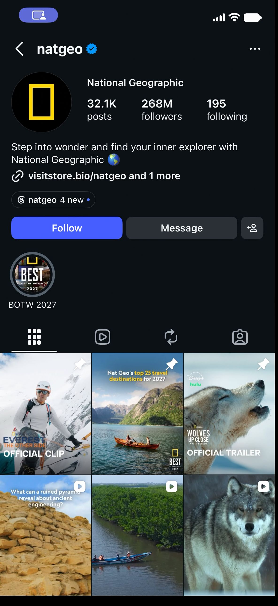

# A real native Instagram profile check

With Instagram already open on a USB-connected iPhone 12, Phonebridge went back to the search tab, searched for `natgeo`, verified the profile header, and read the displayed counts. This run completed on November 8, 2026 at 07:24:17 UTC.

| Profile | Posts shown | Followers shown | Following shown |
|---|---:|---:|---:|
| @natgeo | 32.1K | 268M | 195 |

The screenshot shows Instagram's interface and National Geographic's public profile and posts. They belong to
their respective owners; they are not Phonebridge-authored and not covered by its license. The screenshot is here
only to document this run.

The image is the unchanged result frame. [receipt.json](receipt.json) contains its SHA-256, observation time, task ID and input timeline. Counts are rounded values displayed by the app.

This was a founder test of the standalone export in a fresh Python environment with new app state, using the local phone lease. The Mac already had a paired phone and a system tunnel. The task was launched over the workspace HTTP API; this example does not claim a browser launch, a stock-Mac setup, an outside user, or a taught workflow rerun. Account-verification frames are kept private. Searching leaves recent-search history; no post, like, follow or message was sent.
