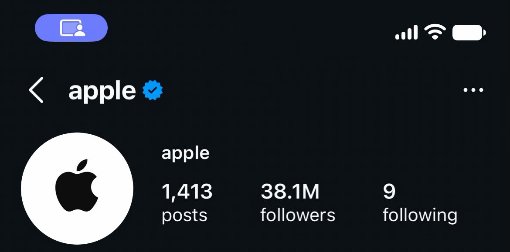

# Teach once, export, run on a new input

A workflow learned from an agent's recorded `@natgeo` profile check was exported, imported unchanged into a fresh Phonebridge installation, and run on `@apple` on a real iPhone 12. It finished in **88 seconds**, with **six taught inputs and three actions to reach its start screen**, without human intervention during the run.

At 09:40:10 UTC on November 8, 2026, it read **1,413 posts, 38.1M followers, and 9 following**. All three values and the profile's handle were checked against one stored result frame.

**This image is a header excerpt.** The unchanged full frame stays private because it includes personalized social context below the counts. The [receipt](receipt.json) records the source frame's hash, dimensions and size, the excerpt's exact bounds and hash, and the input trace. Instagram UI and Apple's content belong to their respective owners; the screenshot is evidence, not project-authored artwork or an endorsement.

[Portable workflow JSON](workflow.json) · [Receipt and input trace](receipt.json)

The ten-step workflow used the same exported file as the earlier attempt. It skipped clearing an empty field, followed Instagram's keyword-results branch through the Profiles chip, and opened the requested profile. Fast OCR missed the one-digit following count, so the task made one accurate read, without further input. Every final value comes from that new image; values from different frames were not combined.

This run used release candidate `0af13e4`, a fresh Python environment, configuration and workspace state on the maintainer's Mac, and the package's own userspace tunnel. The Mac's system tunnel service also remained running. The workflow was imported, confirmed and started through the HTTP API. Afterwards, the completed task and its evidence were inspected in the shipped desktop workspace using a browser. This was a founder-operated installation, not an outside user.

The demonstration came from an agent's journal, screenshots and recorded touch points, not a person's timing. Its unreliable video timing was excluded. The alpha supports Instagram profile checks; this example does not establish arbitrary mobile jobs, multiple-phone operation, broad device compatibility or ban immunity.

Earlier failures are retained in the private development evidence: four desktop attempts before the first private taught success, then three standalone attempts that exposed an optional-adapter import error, padded stream dimensions, and fast OCR dropping a single digit. This is a successful transfer test, not a reliability benchmark. Searches remain in the signed-in account's history; the public profile was observed, not controlled.

To start with your own phone, follow the [quick start](../../../README.md#quick-start) and use **Account check → Teach a workflow from this task → Run a saved workflow**. The JSON above is the actual portable export used in this run; its hash matches the receipt.
