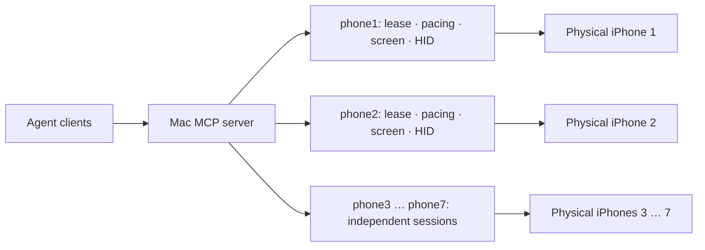

# One Mac, up to seven real iPhones

Phonebridge gives agents a separate screen and control session for each USB-connected iPhone.
The seven-device configuration uses one MCP server, pymobiledevice3's tunnel service, and
device-specific screen streams. It does not run cloud phones, clone app sessions, or share
one phone's screen with another.

**Evidence boundary:** seven concurrent devices are tested with simulated hardware, the real
MCP tools, Bridge and local lease service. Native operation has been demonstrated on **one
iPhone 12, iOS 27.2**. A seven-phone USB hub, capture throughput, power consumption and a
mixed-model fleet have not been validated on hardware. Seven is the current software test
target, not a measured Mac or USB limit.

## Set up the Mac and phones

Use an Apple-silicon Mac, macOS 26, Python 3.12+, `uv`, and iOS 27+ for touch input.
Connect each phone with a data-capable USB cable, unlock it, trust the Mac, and enable
Developer Mode and UI Automation. For seven phones, provide sufficient USB ports and power;
hub compatibility and aggregate bandwidth require a hardware check on your setup.

From a clone of this repository:

```sh
uv sync --frozen
uv run phonebridge devices
uv run phonebridge setup --all --multi-phone stream
```

Setup prints the alias-to-UDID mapping (`phone`, `phone-2`, …). Check that mapping against your physical phones.
It preserves existing configuration and refuses ambiguous identities. To add a named phone
instead of all attached phones:

```sh
uv run phonebridge setup --device YOUR_PHONE_UDID --alias phone7 --multi-phone stream
```

Run the tunnel service in its own terminal, then the bridge in another:

```sh
sudo uv run pymobiledevice3 remote tunneld
```

```sh
uv run phonebridge setup --check
uv run phonebridge serve --http
```

The server listens on Mac loopback at `http://127.0.0.1:8934/mcp`. Restart it after changing
devices, lease, transport or capture settings. Multiple phones use `tunnel = "tunneld"` and `eyes = "stream"`
(or `"dvt"` for still screenshots). The no-root in-process userspace tunnel is a single-phone
option; it cannot safely share its process with another phone's tunnel.

## Give an agent a particular phone

Connect an MCP client using the instructions in the [README](../README.md#use-it-from-an-agent).
Every screen and action call specifies `device`. Use a distinct controller ID for each
stateless client. Devices can run in parallel; actions on the same phone run sequentially.

An example instruction for your agent:

> Use phone-3 only. Read its screen, open Settings → General → About, and report its iOS
> version and model. Do not change settings. Look again after each action, and stop if the
> expected screen is not visible. Release your controller when finished.

This is an example prompt, not a claim that this exact task has been validated on seven phones.
Another agent can simultaneously work on `phone-4`. A competing controller on `phone-3` is
refused. Never reuse a coordinate, OCR item or frame from a different device.

This is a single-operator service for trusted agents on your Mac. Controller IDs prevent
accidental collisions; they are not separate tenant credentials. Read tools can see the
selected phone even while another controller holds it. Keep the service on loopback and
do not give its access token to an untrusted client.

External MCP agents keep their own model context. If you enable the optional built-in
`PHONEBRIDGE_VLM=claude-cli` route, each uncached screen question starts and closes its own
CLI process so one phone's conversation cannot leak into another's. That adds startup latency;
seven simultaneous model processes have not been profiled for memory use. The route is off
by default.



## What “natural behaviour” means here

The input layer draws target-bounded tap positions and press durations, curved swipes with
acceleration and deceleration, variable keystroke cadence, and pauses between actions.
Each physical phone has its own random state; work on another phone does not change its
gesture sequence. A fixed seed is available for reproducible testing. Paste supports longer
text and Unicode. Agents still need to choose the correct control and verify the result.
Advanced callers can provide their own pacing; the natural defaults are not an unalterable
behaviour policy. Experimental digitizer paths and pointer-surface removal are outside this
claim and are not enabled by the seven-phone configuration.

The bridge checks device ownership, lock state, foreground app and stale input. Device
parking and failures are isolated; ambiguous effectful input is not blindly retried. These
mechanisms improve control and recovery. They do **not** establish that input is
indistinguishable from a person, prevent account bans, or authorize automated use of an app.
The phone displays iOS's remote-control indicator.

For workloads requiring physical iOS devices and their own signed-in app sessions, the
architecture provides those devices and sessions locally. Platform trust decisions are not
observable through this bridge. Use official APIs or App Intents where appropriate, respect
account permissions and service rules, and stop on account challenges rather than bypassing them.

## Reproduce the software checks

```sh
uv sync --frozen
uv run pytest -q tests/test_fleet.py tests/test_seven_phones.py tests/test_host_fleet.py tests/test_config.py tests/test_setup.py tests/test_humanize.py tests/test_local_lease.py
```

The fleet tests require no phone and send no external account actions. They check seven
simultaneous MCP inputs, physical-device routing, competing controllers, distinct screenshots,
disconnect isolation, same-phone serialization, a blocked lease command, recovery attribution,
and independent bounded gestures. Driver tests separately exercise transport and capture routing.
The [seven-phone example config](../phonebridge.seven-phones.example.toml) shows the generated layout.

The [native proof](demo/taught-profile-check/) records an imported workflow operating one
real iPhone. It is separate evidence from these multi-device software tests.

## Design sources

- [pymobiledevice3 Python API](https://github.com/doronz88/pymobiledevice3/blob/master/docs/guides/python-api.md):
  the in-process userspace tunnel has one-phone-per-process constraints.
- [Appium's parallel-device guidance](https://github.com/appium/appium-xcuitest-driver/blob/master/docs/guides/parallel-tests.md):
  device identities and session resources must remain distinct. Phonebridge retains its existing
  CoreDevice backend; it does not add an Appium dependency.
- Implementation: [Bridge](../src/phonebridge/bridge.py), [input generation](../src/phonebridge/humanize.py),
  [CoreDevice backend](../src/phonebridge/backends/pmd3.py), [local leases](../src/phonebridge/local_lease.py).
