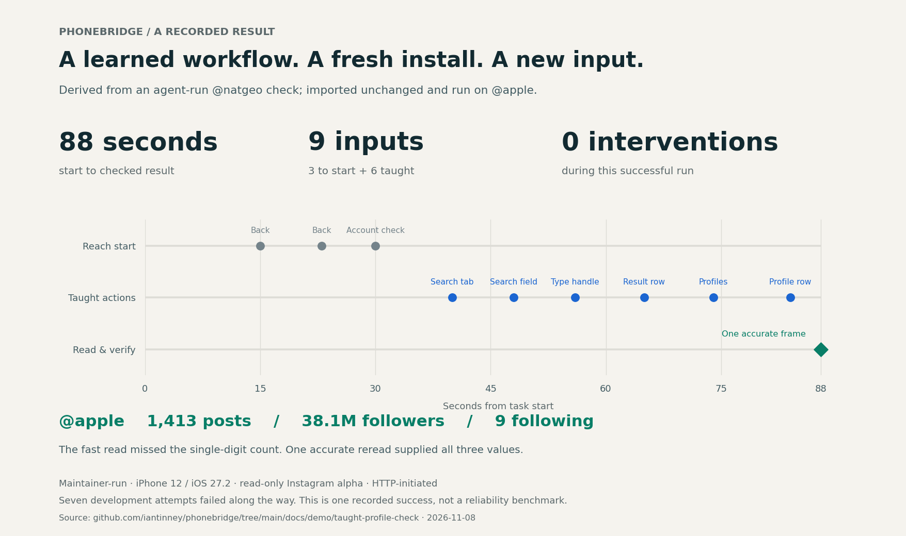

# Give your phone a job.

**Bring the chore you wish your iPhone would just do.**

Phonebridge is an open-source agent workspace for your real iPhone. An agent can see and operate the phone from your Mac. We're building toward one simple interaction: describe the result, let it work, and get back something you can check.

We're inviting creators and early users to help choose what comes next. Bring one recurring phone chore—especially a gap in an otherwise useful Shortcut—and try it with the founder, uncut. If it works, we'll turn it into a reusable job and credit you with your permission. If it doesn't, the recording keeps the failure.

**[Bring one phone chore →](https://github.com/iantinney/phonebridge/issues/new?template=phone-chore.yml)**

This is a public issue. Use fictional examples and leave out private information. Invited by email? Reply there instead.

> **Early alpha:** the checked end-to-end jobs are read-only Instagram profile checks on one iPhone 12. Live input still fails intermittently. This is an invitation to build and test together, not a promise that your chore already works.

## One concrete result

A workflow derived from an **agent-run demonstration** was exported, imported unchanged into a fresh install, and run on a new public profile. It finished in **88 seconds with nine inputs**, without anyone stepping in during that run. When fast text recognition missed a count, one accurate reread supplied all three counts from the same stored image.

[Inspect the receipt, workflow and header excerpt](../demo/taught-profile-check/README.md).

The account observed was Apple's public Instagram profile. Apple is not a customer, collaborator or endorser. The run was HTTP-initiated on a maintainer's iPhone 12 with iOS 27.2. Seven attempts failed during development before this result; this is a demonstrated outcome, not a reliability benchmark. No outside users or installations have been confirmed as of November 8, 2026.

## The creator experiment

| You bring | We contribute |
|---|---|
| One recurring chore on your own phone and accounts | About 30 minutes of setup help |
| Your judgment of whether the result is useful | One recorded attempt, up to 90 minutes, with failures included |
| Editorial independence | Early builds and direct help for 14 days |
| Permission before anything of yours is shared | A sanitized, reusable job if the attempt works |

There is no payment, affiliate arrangement, required positive coverage or exclusivity. You decide whether to publish and disclose the setup help and early access if you do. Either side can stop.

Before a live attempt, we agree on the task, allowed effects and limits once. The agent works within that scope; a new action outside it needs a decision. Purchases, payments, intimate conversations and access to other people's private information are outside this pilot. Current checked workflows are read-only.

Frames are stored on your Mac. We agree separately on any screen data sent to a model or shared for troubleshooting; nothing private goes into the public job or recording without your review.

## Bring your own phone

The current release needs an **Apple-silicon Mac on macOS 26**, a **USB-connected iPhone on iOS 27 or later**, Developer Mode and UI Automation enabled. Allow about two hours for setup and an attempt. Read the [installation requirements and current limitations](../../README.md) before volunteering.

[Try the alpha](../../README.md#quick-start) · [Suggest a chore](https://github.com/iantinney/phonebridge/issues/new?template=phone-chore.yml) · [Inspect the code](https://github.com/iantinney/phonebridge)
